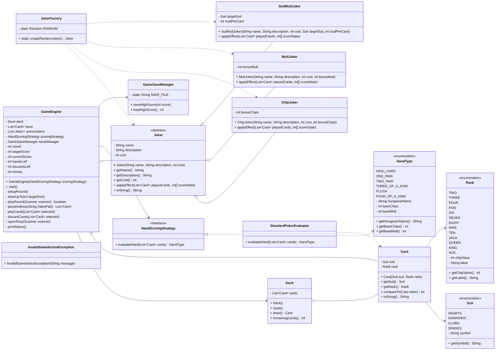

# Balatro Projekt - UML Osztálydiagram és Architektúra

Ez a dokumentum tartalmazza a **Balatro** projekt osztálydiagramját Mermaid formátumban, valamint az egyes csomagok és tervezési minták rövid leírását.

---

## 1. UML Osztálydiagram

---

## 2. Csomagok Struktúrája

* **`hu.balatro.domain`**: A játék alapvető domain modelljei (`Card`, `Deck`, `Joker` és származékai, `HandType`, `Rank`, `Suit`).
* **`hu.balatro.pattern`**: Tervezési minták implementációi (Stratégia minta a pókerkéz értékelésére, Gyár minta a Jokerek előállítására).
* **`hu.balatro.service`**: A játékmenetért felelős üzleti logika (`GameEngine`).
* **`hu.balatro.persistence`**: A rekordok és mentések kezelése (`GameSaveManager`).
* **`hu.balatro.exception`**: Egyedi kivétel osztály (`InvalidGameActionException`).

---

## 3. Alkalmazott Tervezési Minták és OOP Elvek

1. **Stratégia (Strategy) minta**: 
   * `HandScoringStrategy` interfész és `StandardPokerEvaluator` megvalósítás. Lehetővé teszi, hogy a kéz kiértékelési algoritmusát függetlenítsük a játékmenettől.
2. **Gyár (Factory) minta**: 
   * `JokerFactory` osztály, amely centralizáltan felelős a véletlenszerű `Joker` objektumok példányosításáért.
3. **Polimorfizmus és Absztrakció**: 
   * Az absztrakt `Joker` osztályból származó `ChipJoker`, `MultJoker` és `SuitMultJoker` osztályok mind felüldefiniálják az `applyEffect` metódust, sajátos pontszámítási hatást biztosítva.